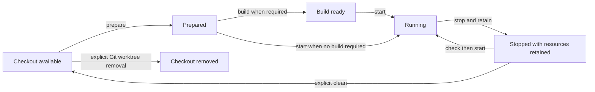

# Workspace lifecycle model

Updated: 2026-10-25

This is a working design for discussion, not an approved command syntax or integration protocol. The user has chosen retention by default with easy explicit cleanup, CLI/TUI/agent support from the start, and both product and managed-workspace builds in the initial scope. The operation names and remaining policies below are proposals.

## Three things have different lifecycles

**The checkout** is a source directory, possibly a Git worktree. Git owns its worktree metadata. TreeTender can discover an existing checkout or request creation/removal through Git; ending a session does not remove it.

**Resources** are the files, database lanes, service registrations, ports, agent context and build artifacts used by a workspace. Each has its own ownership and observed state. A resource can exist while its workspace is stopped, and deliberately retained data can outlive the checkout.

**An operation** is one requested change: inspect, plan, perform steps, check the result and record what happened. It can succeed partly. A workspace with copied files and a failed database operation is partially prepared; it must not be labelled absent or fully ready.

These lifecycles belong together without being collapsed into one running/stopped flag.

## Proposed operations

| Operation | Expected effect | Must preserve |
|---|---|---|
| Inspect | Read Git, declarations, recorded ownership and selected provider state; report missing inputs, drift and readiness | External resources and running/stopped state |
| Plan | Describe selected effects, prerequisites, retention choices, conflicts and steps whose effects are opaque | External resources; planning is not permission to run setup scripts |
| Prepare | Materialize declared files/context, resolve tools/dependencies, provision selected data lanes and configure resources through supported provider operations | Existing data and previously stopped services |
| Build | Run declared workspace build tasks and record their outputs/status | Services stay stopped unless starting them is an explicitly planned prerequisite |
| Start | Activate the selected runnable resources and their explicitly reported prerequisites; verify readiness | Unrelated services and resources |
| Stop | End workspace activity while retaining checkout, data, configuration and recorded ownership | Resources needed for later resume |
| Clean | Explicitly remove selected owned resources, with convenient keep choices; retain the checkout by default | Shared/borrowed resources, kept resources and user-modified files |
| Remove checkout | Offer one explicit operation that plans cleanup plus Git worktree removal, with selected retained resources kept discoverable | Branch history, shared resources and the information needed to clean retained data later |

Creating a checkout, attaching an existing one and explicitly adopting existing resources need distinct ownership treatment; they are not interchangeable forms of prepare. Exact entry points remain open. A location change is also not remove-and-recreate: it should preserve workspace identity and owned resources while repairing path consumers.

Preparation and building do not become a second package manager or compiler. They invoke existing tools and repository tasks. Likewise, starting services invokes Portman or another provider rather than introducing another process supervisor.

## Ordinary sessions retain resources

The settled default is to stop workspace services at session end and keep the checkout/data. Starting again should reuse the retained resources when checks pass. Cleanup must be easy to request explicitly, without manually discovering databases and registrations.

The diagram shows the ordinary successful path. Readiness is derived from resource checks; it is not a permanent state that excludes partial failure, external drift, projects without services or builds that do not require a runnable app.

The proposed convenience is one explicit cleanup operation with a visible scope and keep choices. Optional checkout removal can compose with it. Do not require every caller to run a ritual of cleanup subcommands, and do not hide data deletion behind stop or a caller's routine teardown hook. Legacy tools that use the word teardown need an explicit mapping to TreeTender's stop or cleanup intent.

## Resource categories and policies

| Resource | Preparation/checks | Activity and cleanup considerations |
|---|---|---|
| Copied or generated files | Verify declared sources, provenance and overwrite policy | Keep user edits; delete only outputs still established as owned and selected for cleanup |
| Linked files/context | Resolve source identity/location and distinguish shared inputs from mutable workspace state | Repair owned links after moves; never delete their source when cleaning a link |
| Agent resources | Materialize declared instructions, skills, hooks and tool-config references; inspect missing/private inputs | Keep mutable state isolated; do not copy whole credential/profile homes or rename profiles; do not execute newly materialized hooks as an incidental inspection step |
| Toolchains/dependencies | Invoke declared existing tools and report missing prerequisites | Distinguish workspace installs from shared toolchains/caches; do not remove shared installations during lane cleanup |
| Database/data lanes | Provision selected isolated data, check identity/connection and run declared preparation | A shared database server is borrowed; owned development/test lanes may be cleaned or retained explicitly |
| Services and routes | Configure selected provider-owned registrations and check readiness | Stop only selected activity; route-only providers need an explicit stop/disable policy because they may have no process to stop |
| Ports and endpoint names | Allocate/check claims for the intended workspace and detect conflicts with retained or concurrent workspaces | A stopped listener does not prove a claim is free; releasing and reclaiming assignments must be deliberate |
| Build tasks and artifacts | Run repository-owned build commands, record declared outputs and report freshness/check results | Keep artifact cleanup separate from application data; never infer every untracked file is a disposable build output |
| Custom scripted resources | Invoke declared commands and retain reported handles/results | Opaque effects stay labelled opaque; cleanup/recovery is supported only to the extent the script contract actually provides it |

An adapter supports the relevant capabilities; every resource does not need start/stop/build behavior. A file-copy adapter and a service adapter can both participate without pretending to have the same state machine. The minimum capability contract is still to be designed against real adapters.

Ownership must distinguish resources TreeTender created, existing resources explicitly adopted, and shared resources merely referenced. Matching a name or path does not establish ownership. A cleanup plan must also account for resources that still depend on a selected resource or on a resource the user chose to keep.

## Builds from the beginning

**Managed workspace builds:** describe tasks, prerequisites, tool/environment inputs, outputs and checks without restating Cargo, mise or another build system. Build failure remains visible separately from preparation or service health. Shared caches, generated source and disposable output need different cleanup policies. Initial freshness checks must report their actual evidence; a successful old build is not proof that changed inputs are current.

**TreeTender's own builds:** the first runnable implementation should establish a reproducible Rust toolchain/dependency build, formatting/lint/test gates, and packaging checks for the supported delivery targets. The CLI, TUI and agent interface ship from the same core behavior and are checked together. Exact supported operating systems, artifacts and distribution channels are open; this requirement does not authorize a package publication or public release.

## CLI, TUI and agents are initial callers

All three use one operation planner/executor, ownership model and policy. The TUI must not perform a different kind of cleanup from the CLI, and automation must not scrape human-oriented output.

- CLI: direct, composable operations with explicit scope and useful exit status.
- TUI: inspect resources, preview effects and select operations/retention through the same interface; interactive display is not required by automated callers.
- Agent interface/resources: discoverable operation/configuration descriptions, versioned structured results, inspectable plans, stable error categories and noninteractive invocation. Machine output must omit secret values.

The agent interface is distinct from workspace agent context in the resource table: one lets an agent operate TreeTender; the other makes an agent's tools/context available inside a workspace. Both are part of the initial model. A provider-specific plugin or MCP server is not yet required; the shared CLI contract is the first integration surface to define.

## What execution must take care of

- **Prerequisites and ordering:** prepare the database before a dependent app needs it; stop dependants before removing their resources. A later step cannot assume a failed prerequisite succeeded.
- **Conflicting callers:** two agents or a TUI and a CLI must not concurrently claim the same resource or perform incompatible operations on the same workspace. The locking/reservation mechanism is a planning decision.
- **Partial failure and interruption:** keep the completed resource handles and step outcomes needed to inspect and resume. Do not promise automatic rollback for data changes, user scripts or external providers.
- **Retry:** check recorded and observed state before creating replacements; return an actionable conflict instead of overwriting an unexpected object.
- **Changes after planning:** recheck material inputs and ownership before execution. A stale plan must not silently act on a renamed resource or a different checkout.
- **Unknown provider state:** distinguish unavailable inspection from a missing resource. An unreachable provider is not permission to recreate or delete its resources.
- **Shared and edited state:** user edits, shared databases, shared caches and resources retained by another workspace remain explicit blockers or exclusions for cleanup.
- **Relocation/adoption:** reconcile existing identities and path consumers through provider-supported operations. Discovery does not authorize claiming live resources; a move does not authorize rebuilding their data.
- **Retention after checkout removal:** keep enough cleanup provenance outside the checkout to find the retained resource later. Whether a repository-owned cleanup script must remain available is an unresolved adoption constraint.

## Scenarios to test the model against

| Scenario | Expected result under the proposed model |
|---|---|
| Fresh Rust worktree with local agent context | Prepare declared context/dependencies; build separately; no invented database or service lifecycle |
| Rails worktree with isolated dev/test lanes | Prepare owned lanes/config, run declared builds, start selected services; stop retains data |
| Files prepared, then database provision fails | Report partial preparation with completed effects; retry checks them rather than blindly recreating everything |
| Cleanup requested while keeping a database | Remove only selected resources and retain its identity plus any required cleanup/dependency records |
| Cleanup finds an edited generated file | Report the edit and preserve it unless replacement/removal was explicitly selected |
| Checkout moved with stopped services | Preserve identity/data and reconcile changed paths without starting services |
| Two workspaces want the same reserved port | Report/resolve the claim before execution, even if neither service is listening |
| Portman route has no supervised process | Use declared route lifecycle capability or report unsupported behavior; do not assume a process-stop operation disables it |
| Build produces artifacts but its tests fail | Report build/check outcomes accurately; do not label the workspace fully verified or start it incidentally |
| TUI and agent request the same cleanup | Produce equivalent plans/results under the same policies; coordinate incompatible concurrent changes |

## Decisions still to resolve

- Which operations are first-class commands, and which are compositions or options?
- What exact resources does a default explicit clean select, and which retention presets keep it convenient?
- When should stopping a workspace release its ports/routes versus reserve stable endpoints for later use?
- What capabilities and ownership receipts must a script adapter provide before cleanup can be considered managed?
- How are retained resources cleaned after a repository-owned cleanup script is no longer present?
- What supported build/package targets and TUI scope define the first runnable release?

These questions need product decisions and fixture experiments before implementation planning. No actual command, manifest schema, registry format or adapter protocol is specified by this document.
