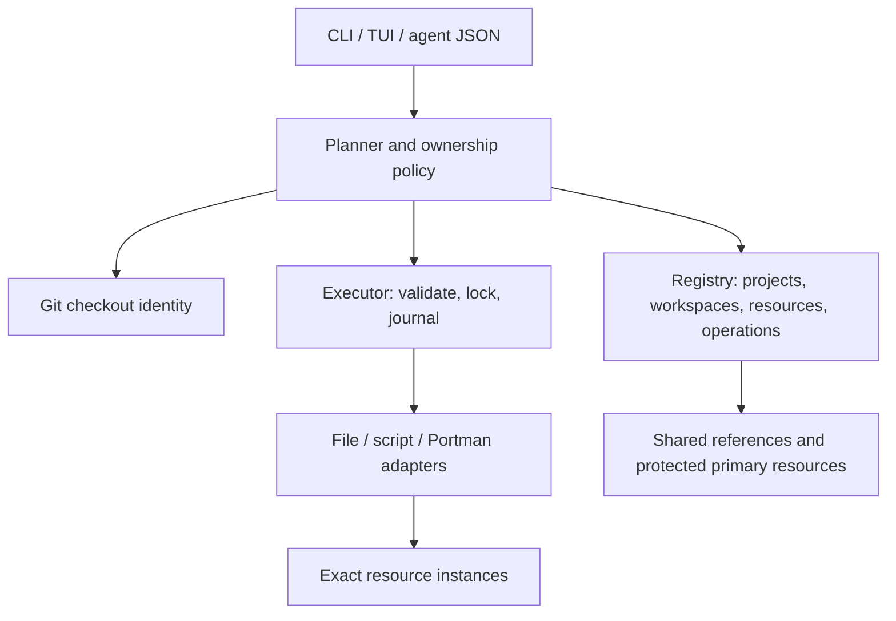
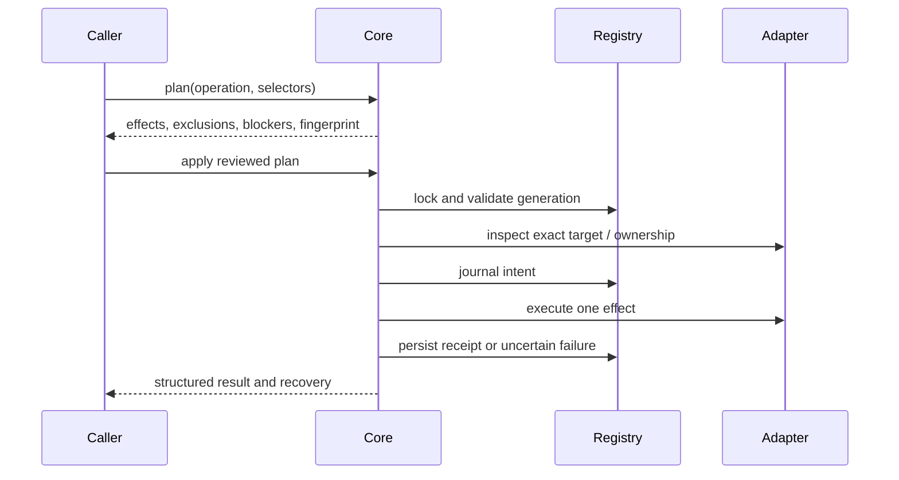
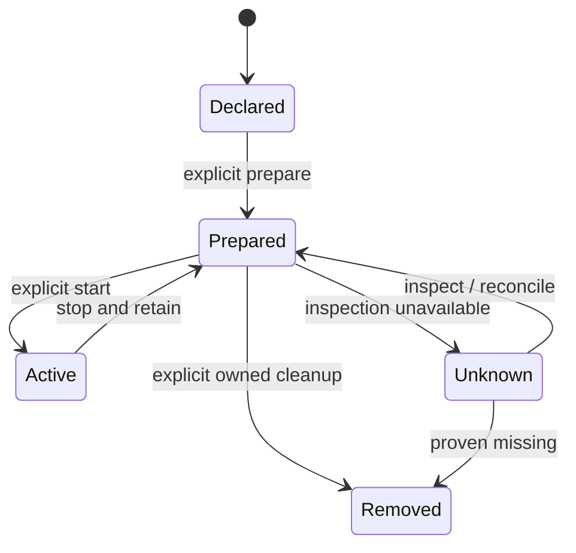
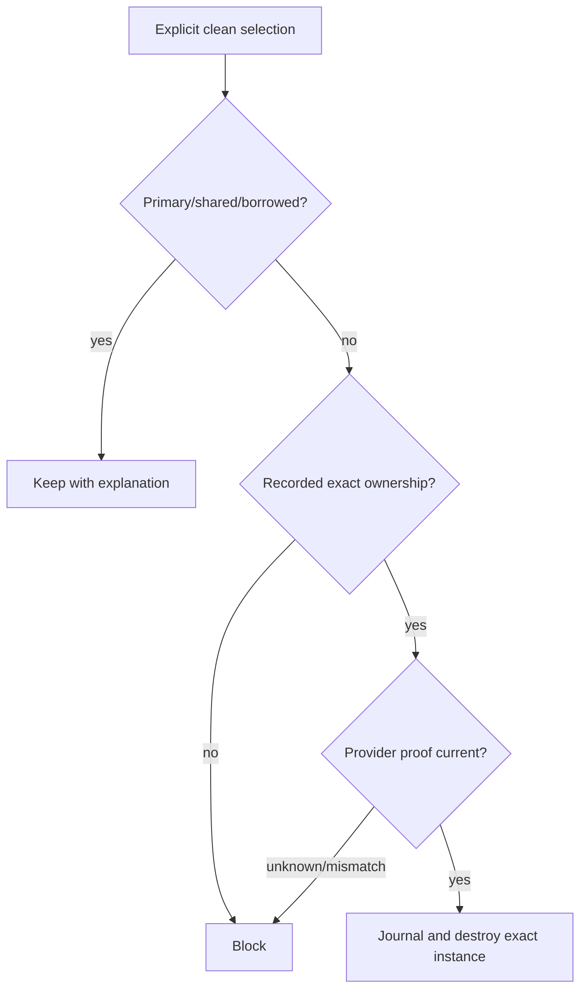

# TreeTender initial release - Plan

## Goal Capsule

Developers and agents can prepare, build, start, stop and explicitly clean isolated development workspaces while preserving primary and shared development resources.
Implement one Rust application, with a local transactional registry and one policy/execution interface used by CLI, TUI and agents.
The user authorized implementation and bounded Claude personal / Codex logpacer collaboration; existing live workspaces, profiles, services and databases remain outside the rollout.
Root coordinator owns integration, verification and delivery. Test only disposable fixtures.

## Product Contract

### Requirements

**Identity and safety**

- R1. Discover repositories and linked checkouts through Git; registry identity survives path changes and is independent of branch names and remotes.
- R2. Protect primary checkout resources by default and never allow worktree cleanup to destroy shared or borrowed resources.
- R3. Destruction requires recorded ownership of an exact resource instance, an explicit cleanup request and successful provider inspection; names or paths alone are insufficient ownership evidence.
- R4. Ordinary stop retains data and checkout; clean can select or retain any resource kind without database-specific policy.
- R5. Plan is side-effect-free; execution revalidates material inputs, serializes conflicting mutations and journals partial failure before acknowledging success.

**Lifecycle and integration**

- R6. Repository TOML declarations describe resource dependencies, explicit file copying/linking, builds/checks, services and agent context; private local overlays are separate.
- R7. Prepare never starts services; build is separate from prepare/start and tracks declared artifacts and verification outcomes.
- R8. Small external adapters provide structured inspect/prepare/start/stop/destroy operations for database lanes, storage namespaces and custom resources; unknown provider state blocks destructive operations.
- R9. Provide an optional Portman integration that always addresses an explicit service and never issues an empty global operation.
- R10. Retain receipts, recovery information and adapter provenance centrally when a checkout disappears; explicit non-destructive forget releases claims while retaining audited receipts, and ambiguous locations block cleanup rather than guessing.
- R11. Port claims account for stopped workspaces; root/shared resource identities cannot be claimed by another workspace.

**Interfaces and delivery**

- R12. CLI, TUI and structured agent discovery/operations share the same planner and executor, including plan review before destructive execution.
- R13. Agent resources (instructions, skills, configuration) use ordinary declared file/link resources; no agent provider is mandatory.
- R14. Include reproducible Rust builds, checks, packaging and CI, realistic disposable adapter examples and end-to-end tests.

### Acceptance examples

- AE1 (R2,R3): a linked worktree declares the same database target as primary. Prepare/clean refuses to claim or destroy it; the primary receipt survives.
- AE2 (R4,R8): stop leaves both a database namespace and storage directory intact; clean with a retain selector deletes only the selected owned resource.
- AE3 (R3,R5): replace an owned file or provider ownership token after planning. Apply refuses the stale plan and preserves replacement state.
- AE4 (R5,R10): an adapter fails after a prior resource succeeds. The completed receipt and failed operation remain inspectable; retry reconciles rather than duplicates.
- AE5 (R7,R12): a failed build is visible through CLI/JSON/TUI and does not start any service.
- AE6 (R9): a service-less Portman declaration fails validation before any Portman call.

### Boundaries

TreeTender is not a supervisor, secret store, agent scheduler, database server or Git replacement. External scripts are trusted code: ownership checks cannot sandbox arbitrary malicious commands. No live resource adoption, legacy migration, public release or license choice is included.
Git checkout creation/removal may be delegated to existing tools; resource cleanup never implicitly deletes a checkout. Provide explicit detach/forget only when ownership receipts are retained or cleaned safely.

## Planning Contract

- KTD1. One Cargo package with a library core and thin CLI/TUI. Use serde/TOML, clap, SQLite transactions and typed JSON; keep modules around manifest, Git identity, registry, planning/execution and adapters.
- KTD2. Store machine state under a configurable state directory (platform default), with a per-registry process lock and SQLite persistence. IDs are random stable values stored against Git common-dir/worktree metadata; relocation must be explicit if identity cannot be proven.
- KTD3. Register primary identity on discovery and protect its resources intrinsically. Shared declarations are references, never deletable instances; owned allocations are workspace-scoped. Registry uniqueness and provider owner tokens bind backend identity to the allocating workspace. Never offer a blanket force bypass.
- KTD4. Persist a plan fingerprint over manifest/context, target workspace and recorded resource generation. Apply rechecks it under lock. Journal intent before external effects, store each completed receipt immediately; ambiguous interrupted effects require inspect/recovery.
- KTD5. Resource adapters are local argv commands with versioned JSON input/output, bounded output and explicit capabilities. No shell interpolation by core. Only managed owned instances can expose destroy; inspect returns present/missing/unknown and owner/instance proof.
- KTD6. File operations use explicit lists, safe relative destinations, refuse symlink escapes and preserve edits. Never copy all ignored files or secrets by default. Agent context follows identical rules.
- KTD7. Build/task dependencies have deterministic cycle validation and fail-fast ordering. Service start/stop is delegated to explicit adapters; stop runs in reverse dependency order and retains persistent receipts.

### Relationships

### Operation flow

### Resource state

### Destruction decision

### Assumptions

macOS and Linux are initial supported hosts. The registry is local to one user/machine; external providers remain authoritative for actual existence. Scripts must supply ownership proof and support inspection to participate in managed cleanup. Provider timeouts and missing executables return actionable failures. No commands are permitted to inherit misleading Git discovery environment variables.

## Implementation Units

### U1. Registry and ownership core

Requirements: R1-R5,R10,R11; KTD2-KTD4. Files: `src/model.rs`, `src/git.rs`, `src/registry.rs`, core tests. Implement stable identities, protected primary/shared policy, atomic claims, durable operations and locking. Test duplicate targets across workspaces, branch renames, stale plans, concurrent callers and interrupted operations using temporary Git repositories.

### U2. Manifests, plans and adapters

Requirements: R3-R11,R13; KTD5-KTD7. Files: `src/manifest.rs`, `src/engine.rs`, `src/adapter.rs`, adapter examples/tests. Implement explicit dependency ordering, file safety, generic resource receipts and structured command adapters; Portman explicit-service boundary. Test partial failures, modified files, traversal/symlinks, unknown inspection, wrong ownership, build failures and retain selectors.

### U3. CLI, TUI and agent interface

Requirements: R12,R13; KTD1. Files: `src/main.rs`, `src/cli.rs`, `src/tui.rs`, interface tests. Provide init/register/status/list/plan/apply/lifecycle commands and discoverable JSON schema/examples. TUI displays resources/plans/results and uses the same executor; destructive actions require reviewing a plan. Test command parity, stable JSON errors, noninteractive input and terminal restoration.

### U4. Delivery and documentation

Requirements: R14. Files: `Cargo.toml`, `Cargo.lock`, `.github/workflows`, `README.md`, `docs`, `examples`, integration tests. Document commands, trust boundaries and supported capabilities, and prove the complete fixture lifecycle. Check primary/shared resources remain intact after every cleanup scenario. No tests touch user state.

## Verification Contract

Required: `cargo fmt --check`, `cargo clippy --all-targets -- -D warnings`, `cargo test --locked`, `cargo build --release --locked`, `cargo package --locked --allow-dirty` without publishing. CI runs Linux and macOS. Exercise the actual binary with an isolated state directory and temporary Git repositories, including linked worktrees and fake external providers. Exercise TUI rendering/input with an in-memory terminal and a PTY smoke check where possible. Inspect every worker diff before integration.

## Definition of Done

All R1-R14 have working documented interfaces and meaningful fixture evidence. Primary/shared/default resources survive adverse cleanup scenarios. Commands report partial failures without losing receipts. CLI/TUI/agent operations share behavior. Required checks pass, changes are committed on a feature branch and pushed to a reviewable PR. Existing workspaces and profile defaults are untouched.
