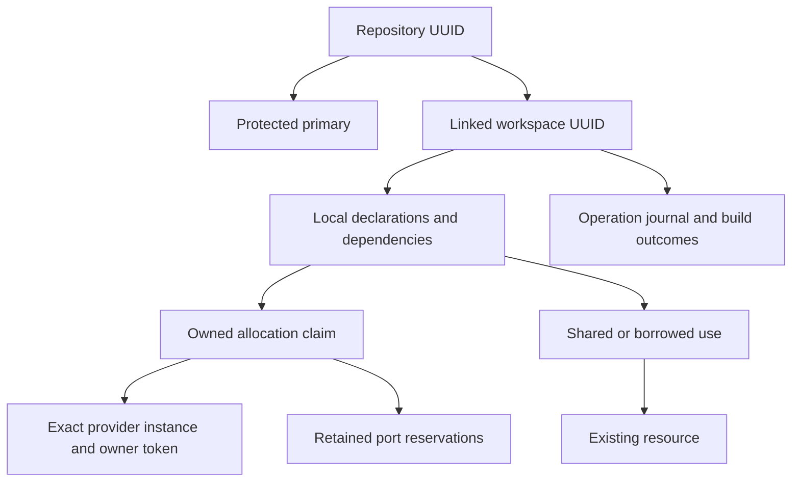

# Registry and resource relationships

TreeTender stores machine state in a private SQLite registry. Portable declarations remain in the repository; Git remains authoritative for actual checkouts. A provider remains authoritative for whether its resource exists and which exact instance it is.

| Record | Identity and purpose |
| --- | --- |
| Repository | Stable UUID in the Git common directory; independent of origin, owner or current path |
| Workspace | Stable UUID in its Git directory, bound to a repository and current checkout path; a name fixed at first registration and unique within the repository |
| Primary | The ordinary checkout whose Git directory is the common directory; intrinsically protected |
| Declaration snapshot | Registered resource uses, including shared/borrowed references that survive checkout disappearance |
| Allocation claim | Exact provider target, allocating workspace/resource, token, proof, declaration and state |
| Port reservation | A logical numeric host-port claim retained while stopped; not an OS listener or automatic port allocator |
| Operation | Reviewed intent, completed/uncertain steps, failure and recovery provenance |
| Build outcome | Task definition, declared input fingerprints and resulting artifacts within an operation |

Ownership and use are separate. A borrowed/shared reference never gains destruction rights. Another registered workspace's protected use can block the owning workspace's cleanup. Removing a checkout does not automatically remove its references or its external resource receipts.

## Accounting and execution are separate

The primary purpose is to account for resources attached to a tree/lane while existing tools remain responsible for their operation. A declaration records a relationship; an observation reports backend state; an allocation receipt records an explicitly managed instance. These are different kinds of evidence. Registration alone does not create an allocation receipt or authorize deletion.

Use shared/borrowed references when an external tool owns the lifecycle, even when the resource is dedicated to a single lane. Such references remain useful for discovery, usage relationships and cleanup protection. They do not require a TreeTender database driver. Invoke an existing tool only for capabilities the caller actually requests.

A resource without `adapter` is passive. `register` stores its target, declared ownership/use, dependencies and optional `description`/`manager` notes. It creates no allocation claim or port reservation, including for primary checkouts. Status shows the declaration without fabricating a backend observation or reporting an intentionally absent observer as a failure. CLI/TUI label it passive; JSON omits the adapter and has no observation entry for it.

Passive records are protected regardless of their declared ownership. Matching targets protect allocations used by other registered workspaces; a retained passive dependent protects its declared parent from cleanup. Registered uses remain protective until re-registration refreshes them, or an absent checkout's references are explicitly forgotten. Edit declarations and register again to update live associations. Targets must match the owning resource's declaration to express shared use of an external allocation.

`depends_on` can describe relationships between passive resources without executing anything. If a managed operation or task requires a passive resource as a live prerequisite, planning blocks: declared association does not prove readiness. Configure an observation adapter and shared/borrowed ownership when actual readiness evidence is required for an externally managed resource.

Removing an adapter from a managed declaration preserves its old allocation receipt. It grants no new effects and does not release the claim automatically. Restore an explicitly managed declaration for cleanup, or deliberately use reviewed `forget` to retain the backend instance and release the claim. Adding an adapter does not adopt an existing foreign instance. External receipt import is not implemented.

## Lifecycle flows

`inspect` discovers Git/config without adopting resources. `register` records identity and reference declarations; it does not provision databases or start services. `prepare` creates explicitly declared isolated resources. `build` and `check` run declared tasks separately. `start` and `stop` delegate verified service effects; stop retains persistent state.

`clean` selects verified owned resources for actual destruction. It preserves primary/shared/borrowed resources, retained dependencies and edited files. The caller reviews a frozen plan before applying it. An unavailable provider, unknown ownership or a changed exact instance blocks effects.

`adopt --only RESOURCE` plans claiming existing unmarked state through an adapter that supports adoption. The plan freezes the observed instance; apply records a new allocation receipt only for that exact instance. It never adopts a primary workspace resource or state that already has a receipt.

`forget --only RESOURCE` plans releasing TreeTender's claim, ports or an orphaned reference while retaining the instance. It preserves receipt provenance in operation history. It is the recovery route when a provider context cannot be verified or a generated file has become user-owned state. It never adopts an object on a future prepare.

## Paths and recovery

Paths are current locations, not identities. Re-register an intentionally relocated checkout to reconcile its location and verified file claims. Recycling a worktree path creates a new Git identity; an old record remains addressable by ID for its retained resources, without authorizing access to the replacement checkout's files or scripts.

A missing path with live Git metadata is ambiguous: repair and register a moved checkout, or prune through Git only when asserting deletion. If the entire repository/common directory disappears, cleanup and reference release remain blocked until its identity/location is restored. Clean or detach linked resources before permanently deleting the whole repository. Bare-repository layouts currently return an explicit unsupported-layout error.

Inspect records with `list`, `status` and `history`. Use `--repo WORKSPACE_ID` for a missing/replaced checkout. Resource inspection may execute declared provider inspection code; the registry is not itself proof of backend existence.

Script adapters must persist and return their own allocation proof. TreeTender writes provisional ownership before effects, then records completed receipts. A failed or interrupted operation can leave an uncertain allocation; it must be inspected and reconciled or explicitly forgotten. Arbitrary scripts are trusted code, and TreeTender does not promise transactional rollback of external effects.

The registry serializes mutations. A busy operation returns a bounded `registry_busy` error to other callers. Saved plans fingerprint relevant receipts, claims, references, declarations and inputs; unrelated operation history does not invalidate them.
